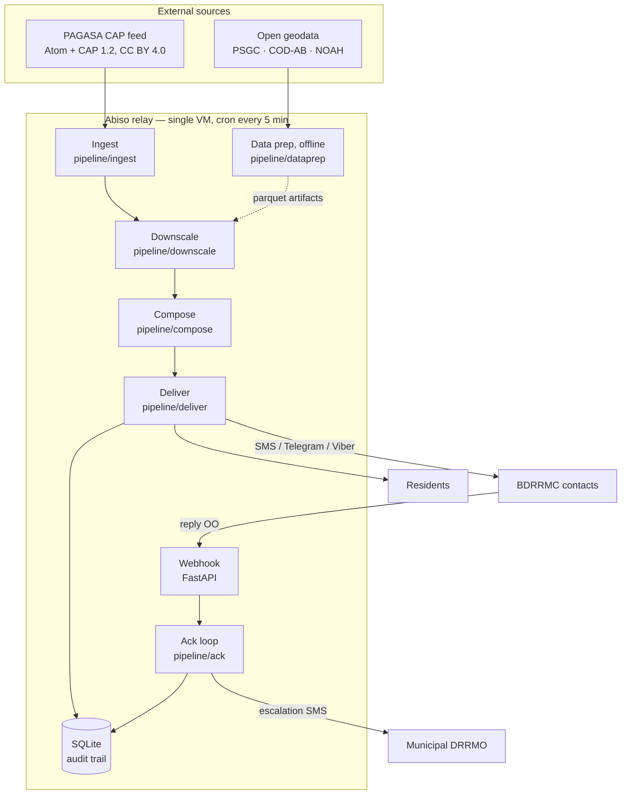
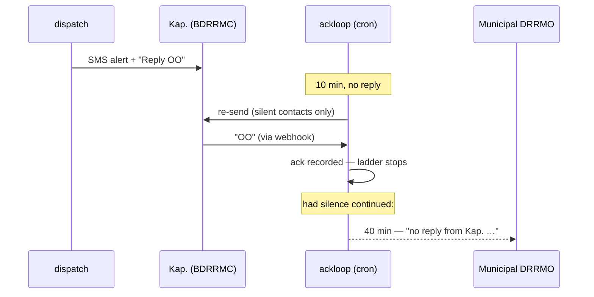

# Abiso — architecture

Last-mile disaster alert relay for Philippine barangays. This document
describes how the system is built and why. For the project plan and
research basis see [PLAN.md](PLAN.md); for setup and commands see
[README.md](README.md).

**Audience:** a developer joining the project, or a technically-minded
DRRMO/civic-tech partner evaluating it.

---

## 1. Context and goals

PAGASA's forecasts are accurate and its warnings are free and public, but
they are issued per **province** in technical language, while the legal
duty to act — trigger evacuation, open the evacuation center — sits with
the **barangay** (RA 10121). Deaths in recent typhoons (Kristine 2024,
Kalmaegi/Tino 2025) clustered where rainfall warnings never became
barangay-level instructions, and where nobody knew whether the warning
had even been received.

Abiso fills exactly that layer:

1. **Downscale** province-level official warnings to specific at-risk
   barangays using open hazard and boundary data.
2. **Translate** them into plain-language instructions (Filipino/Cebuano,
   human-approved templates — never machine translation) delivered over
   redundant channels, SMS first.
3. **Close the loop**: barangay DRRM contacts acknowledge by reply;
   silence escalates on a ladder; every event is an auditable record —
   the accountability artifact LGUs need under RA 12287.

**Non-goals / legal posture.** Abiso never forecasts and never orders
evacuation. It relays official PAGASA warnings, always attributed and
timestamped, phrased as advisories. Altering or inventing warnings is the
liability line (RPC Art. 154); the compose layer is designed so crossing
it is structurally hard.

## 2. System overview



One Python process tree, one SQLite file, one cron line:

```cron
*/5 * * * *  cd /opt/abiso && make poll dispatch ackloop
```

There is deliberately no queue, no broker, no background workers: at
pilot scale (a handful of barangays, tens of contacts, a few alerts per
day at peak) the database is the coordination point and every stage is a
short-lived idempotent process. Crash recovery = the next cron tick.

## 3. Components

### 3.1 Data prep (offline) — `pipeline/dataprep/`

Runs at setup and on quarterly refresh, not in the alert path. Produces
three parquet artifacts under `warehouse/`:

| Artifact | Built by | From | Contents |
|---|---|---|---|
| `gazetteer.parquet` | `psgc.py` | psgc.gitlab.io API (PSA XLSX optional via `PSGC_XLSX`) | 43,778 rows: every region/province/city/barangay with **10-digit PSGC code** (the primary key everywhere), name, level, parent prefixes, and **old 9-digit code** — the exact format PAGASA CAP `SAME` geocodes use |
| `adm4_region07.parquet` | `boundaries.py` | OCHA COD-AB PHL (HDX API) | 3,003 Region VII barangay polygons (GeoParquet, WGS84), P-codes normalized to bare PSGC |
| `barangay_hazard.parquet` | `noah.py` + `hazard_intersect.py` | NOAH hazard shapefiles (bettergovph HF mirror, ODbL) | 12,815 rows × 1,202 Cebu barangays: `(psgc, hazard_type, scenario, severity, pct_area)` from spatially intersecting flood 5/25/100-yr, storm-surge SSA1–4, and landslide layers with the ADM4 polygons |

Two rules encoded here that everything downstream relies on:

- **Barangays are identified by 10-digit PSGC code, never by name.**
  Thousands of barangays share names ("Poblacion", "San Isidro"); code
  prefixes give free hierarchy (region `code[:2]`, province `code[:5]`,
  city/municipality `code[:7]`).
- **PSGC churns quarterly** (renames, new barangays, the 2024 BARMM
  reorganization). `make psgc` re-ingests; boundary geometry lags the
  attribute list by ~2 years, which is tolerable because fan-out is
  over-inclusive by design (§6).

### 3.2 Ingest — `pipeline/ingest/`

- `cap_poller.py` polls the PAGASA CAP Atom feed
  (`publicalert.pagasa.dost.gov.ph/feeds/` — official, CC BY 4.0, the
  only open machine-readable PH alert source). For each new entry it
  saves the **signed CAP XML verbatim** to `data/cap/raw/` and appends a
  normalized JSON line to `data/cap/alerts.jsonl`. Filesystem presence is
  the seen-state, so the poller is idempotent and cron-safe.
- `cap.py` parses CAP 1.2 (identifier, `msgType` Alert/Update/Cancel,
  severity, parameters, areas with polygons and SAME geocodes) and the
  Atom envelope. Malformed polygons are dropped, not guessed at.
- `track.py` snapshots the NOAH typhoon-track GeoJSON, content-addressed
  by hash so unchanged forecasts write nothing.

The raw XML directory is the audit root: every message Abiso ever sends
must be traceable to a signed PAGASA document stored here.

### 3.3 Downscale — `pipeline/downscale/fanout.py`

The core value-add: no official source issues barangay-level alerts, so
`Downscaler.fan_out()` derives them. Three resolution paths, most
precise first, results unioned:

1. **polygon** — CAP polygon any-intersects a barangay boundary
   (GeoParquet, shapely).
2. **geocode** — the CAP `SAME` value is an old 9-digit province PSGC;
   the gazetteer's crosswalk resolves it exactly (a `RRPP → RR0PP`
   heuristic exists as fallback and is labeled `geocode-heuristic`).
3. **name** — `areaDesc` matched against province names plus the alias
   table (`reference/province_aliases.csv`: "Western Samar" → Samar,
   etc.).

Matched provinces fan out to all child barangays by code prefix (a table
join, no GIS at alert time), then each hit is annotated from
`barangay_hazard` for the hazard type mapped from the CAP event
(rainfall/flood → flood, surge/cyclone → storm_surge, …) and ranked by
`pct_area`.

**An area that resolves to nothing goes into `result.unresolved` and the
CLI exits non-zero.** Unknown geography pages a human; it is never
silently dropped.

### 3.4 Compose — `pipeline/compose/`

`TemplateBook` selects a template by priority-ordered matching over
`templates/*.yaml` (`msgType` exact → event regex → severity → CAP
parameter regex; `Cancel` carries priority 100 so an all-clear can never
render as a fresh warning), then slot-fills it. 13 templates: flood ×3
severities, wind signals 1–5 plus fallback, storm surge ×2, all-clear.

The engine enforces the safety envelope (all raise `ComposeError`, which
is never caught to "send anyway"):

| Guard | Mechanism |
|---|---|
| No incomplete instructions | missing slot (`{evac}` etc.) raises — fail closed |
| No unreviewed language | per-language `status:` in YAML; anything but `approved` refuses to render without `allow_draft` (tests/preview only). Approval requires a named `reviewed_by`. en + fil are approved; ceb awaits a translator |
| No URLs | NTC MC 12-12-2023 — carriers block SMS with links; engine rejects |
| Honest SMS cost | real GSM 03.38 septet counting (extension chars cost 2); test-enforced 1-segment budget for en + fil with realistic slot values |
| Attribution always | every message opens `PAGASA <label> <PH-time stamp>`; slots pass through untranslated |
| No machine translation | there is simply no MT call in the codebase; templates are the only text source (FilBench 2025: LLMs hallucinate in PH languages — fatal in an evacuation order) |

The ack request (`Reply OO kung natanggap.`) is appended only for the
BDRRMC tier.

### 3.5 Deliver — `pipeline/deliver/`

- `store.py` — SQLite persistence (§4).
- `channels.py` — adapters with a global safety default: **dry run
  unless `ABISO_LIVE=1` AND the channel has credentials.** Dry-run sends
  are printed and recorded as `queued` with `dry_run: true`, so drills
  rehearse the entire pipeline with zero send risk.
  - **SMS** — Semaphore (`api.semaphore.co`), PH-local aggregator,
    ₱0.56/segment, registered alphanumeric sender ID.
  - **Telegram** — `sendMessage` to a per-barangay channel.
  - **Viber** — writes copy-paste-ready text to `data/outbox/viber/`;
    Communities are posted manually (the bot API's €100/month fee is not
    worth it at barangay scale).
  - **Messenger** — inbound only (§7); Meta removed all compliant
    unsolicited-broadcast paths by April 2026.
- `dispatch.py` — the orchestrator. Per subscribed barangay: SMS to each
  active subscriber in their own language (resident tier only for
  Extreme/Severe — cost control; BDRRMC always), then one stacked
  multi-language post to the broadcast channels. Idempotent per
  `(cap_identifier, psgc)` and tracked in a dispatched-alert ledger, so
  re-runs and crashes never double-text anyone. Per-recipient failures
  are recorded and skipped over — one bad profile never blocks a
  barangay.
- `subscribers.py` — admin CLI. `add` refuses without `--consent-ref`:
  Data Privacy Act opt-in documentation is structurally mandatory.
- `webhook.py` — FastAPI. Authenticates every inbound request, then
  records the reply verbatim into `inbound_message`; interpretation
  belongs to the ack loop, keeping the webhook dumb and the logic testable
  offline. An `OO` stops an escalation, so authentication fails closed:
  SMS needs the shared `WEBHOOK_TOKEN` (`X-Abiso-Token` header, or
  `?token=` for aggregators that can't set headers), Telegram the
  `secret_token` registered with `setWebhook`, Messenger a valid
  `X-Hub-Signature-256` HMAC. A channel without its secret answers 503,
  and a rejected request is never recorded.

### 3.6 Ack loop — `pipeline/ack/`

The differentiator: fire-and-forget is what every existing PH channel
already does; Abiso tracks receipt.

- `match.py` — a reply acks when its sender resolves to an active
  subscriber (msisdn compared on last-10 digits so `+639…`/`09…` both
  work; Telegram by id), its first token normalizes to an ack word
  (`OO`, `YES`, `OPO`, …), and the subscriber has an un-acked alert SMS
  within 24 h — the most recent one gets the ack. A non-ack reply from a
  known contact ("Tulong!") is surfaced as **NEEDS HUMAN**, never
  dropped: mid-typhoon that message matters more than any ack.
- `escalate.py` — for each instance with silent BDRRMC recipients, fire
  the highest due rung not yet done:

  | Silence | Step | Action |
  |---|---|---|
  | 10 min | `resend_sms` | identical message, silent contacts only |
  | 25 min | `notify_alternate` | operator task: call them / send someone |
  | 40 min | `notify_drrmo` | SMS the municipal DRRMO (profile `drrmo_msisdn`) naming who never answered |

  **At most one rung per run** — a stalled cron catching up can never
  machine-gun a barangay captain. Every step is an `escalated` audit
  event; instances older than 6 h stop escalating (the event has passed;
  the report is the record).
- `report.py` — per-alert Markdown timeline to `data/reports/`: ack
  rate, time-to-ack per person, escalations, failures, unmatched
  inbound. This is the RA 12287 accountability artifact and the pilot's
  proof of value.



## 4. Data model

Runtime state is one SQLite file (`data/abiso.db`), created and migrated
by `store.py`. [warehouse/schema.sql](warehouse/schema.sql) is the
equivalent Postgres DDL — the migration target if scale ever demands it
(§6).

| Table | Role | Key semantics |
|---|---|---|
| `subscriber` | who gets alerts | tier `bdrrmc`/`resident`; `consent_at`/`consent_ref` NOT NULL; per-subscriber `language` |
| `alert_instance` | one (CAP alert × barangay) | UNIQUE `(cap_identifier, psgc)` — the idempotency anchor; carries `matched_via`, `hazard_type`, `max_pct_area`, `severity` |
| `delivery_event` | **append-only** audit log | kinds `queued/sent/delivered/failed/skipped/ack/escalated`; JSON `detail` holds rendered text, provider ids, errors, escalation steps. Nothing here is ever updated or deleted |
| `dispatched_alert` | ledger for `dispatch --new` | one row per processed CAP identifier |
| `inbound_message` | replies, verbatim | `matched_alert_instance_id` set by the ack matcher; NULL = needs human review |

File-based data lives beside it: `data/cap/raw/` (signed CAP XML — the
audit root), `warehouse/*.parquet` (read-only lookups), `data/outbox/`
and `data/reports/` (operator-facing artifacts).

## 5. One alert, end to end

PAGASA raises a red rainfall / Extreme flood advisory covering Cebu at
8 PM:

1. **poll** (≤5 min later) fetches the CAP XML, archives it, appends the
   JSON record.
2. **dispatch --new** parses it: `select()` → `flood_extreme`; fan-out
   resolves the `SAME` geocode `072200000` via the old-code crosswalk to
   province prefix `07022`, expands to its barangays, intersects the CAP
   polygon, and ranks by NOAH flood `pct_area`. Subscribed pilot
   barangays remain (e.g. Cansaga, Consolacion — 59 % flood-exposed).
3. Compose renders per subscriber:
   `PAGASA Baha-Extreme Hul2 8PM: Brgy Cansaga: Malubhang baha. Kung
   malapit sa ilog o mababang lugar, pumunta sa Cansaga Barangay Hall.
   Reply OO kung natanggap.` — 157/160 GSM septets, one ₱0.56 segment.
4. Deliver sends SMS to every BDRRMC contact and (severity is Extreme)
   opted-in residents; posts the stacked fil + en rich text to Telegram;
   writes the Viber outbox file. Every send is a `delivery_event` row.
   A barangay whose evacuation center is not yet collected gets a
   `failed` event with the exact reason — and no message.
5. Kap replies `OO` → webhook records it → next **ackloop** tick matches
   it to the instance, records `ack`. Had he stayed silent: re-send at
   10 min, operator call task at 25, DRRMO SMS at 40 — each on its own
   audit row.
6. `make report` renders the timeline: ack rate, minutes-to-ack, who
   never answered. When PAGASA cancels, the `Cancel` CAP message selects
   the all-clear template (priority 100) and the cycle repeats.

## 6. Key decisions and trade-offs

| Decision | Why | Trade-off accepted |
|---|---|---|
| **SMS backbone, Messenger inbound-only** | Meta deprecated every compliant unsolicited-broadcast path by Apr 2026; free FB data in PH is promo-only now. SMS needs no smartphone/data and survives congestion | ~₱1,200–4,500/mo per 2,000-household barangay; sender-ID registration lead time |
| **Template matrix, no MT/LLM in the alert path** | 2025 benchmarks show frontier LLMs hallucinate in PH languages; a wrong number or negation in an evacuation order kills. Post-Haiyan evidence: jargon ("storm surge") was not understood — hence *daluyong*/*dagkong balod* | New languages need a human translation pass (ceb currently gated) |
| **Over-inclusive fan-out** (any-intersect, province-wide expansion) | For warnings, a false positive is an annoyed barangay; a false negative is Kalmaegi | More messages; mitigated by hazard ranking + subscription scoping |
| **SQLite over Postgres (pilot)** | one-person ops, zero services, trivially backed up (`cp` the file) | single-writer; fine at pilot scale. `schema.sql` keeps the PG exit door open |
| **No queue/broker; cron + idempotent stages** | crash recovery = next tick; nothing to babysit in a typhoon | ≤5-min latency floor (matches CAP update cadence anyway) |
| **Viber via manual outbox** | Community posting is free; bot API is €100/mo + per-message | an operator pastes during events — acceptable at 3–5 barangays |
| **Dry-run as the global default** | the worst failure mode is accidentally alerting a barangay during development or a drill | going live is an explicit env-var act |
| **One escalation rung per run** | a stalled loop catching up must not machine-gun a captain with 3 steps at once | worst-case ladder completion is stretched by the cron interval |
| **Append-only audit log** | RA 12287 accountability requires records nobody can quietly rewrite | storage growth (negligible at this scale) |

## 7. External integrations

| Integration | Direction | Format / terms | Notes |
|---|---|---|---|
| PAGASA CAP feed | in, 5-min poll | Atom + CAP 1.2, XML-DSig, **CC BY 4.0** | province-level geocodes + polygons; `gfa`/`wcp`/`acp`/`tcp` types |
| NOAH typhoon track | in, poll | GeoJSON | context only, not an alert trigger |
| PSA PSGC (via psgc.gitlab.io) | in, quarterly | JSON (XLSX authoritative) | carries both 10-digit and old 9-digit codes |
| OCHA COD-AB PHL | in, on refresh | shapefile via HDX API | boundaries are indicative, not authoritative |
| NOAH hazard maps | in, one-time | shapefiles, **ODbL** | bettergovph HF mirror; `{Hazard}/{Scenario}/{Province}.zip` layout |
| Semaphore | out (SMS) + in (webhook) | REST | sender ID ≤11 chars, registered; no URLs in body |
| Telegram Bot API | out + in | REST | free; per-barangay channels |
| Viber | out (manual) | — | Community posts from outbox files |
| Messenger Platform | in only | webhook + verify handshake | user-initiated conversations only |

## 8. Testing and operations

- **47 pytest tests**, no network required: CAP parsing (fixture mirrors
  real PAGASA structure), fan-out (namesake barangays, crosswalk vs
  heuristic, unresolved surfacing), compose (template CI — every
  template × language must slot-fill, stay GSM-clean, fit the segment
  budget; draft gate; fail-closed), dispatch (dry-run, idempotency,
  severity gate), ack (word/msisdn normalization, ladder order,
  one-rung-per-run, needs-human, report content), webhook auth (every
  channel rejects a missing or wrong secret, records nothing on reject,
  and fails closed when unconfigured).
- **Ops surface**: `make poll dispatch ackloop` on cron; `make serve`
  for the webhook; `make report` after events; `make psgc` quarterly.
  Non-zero exit from dispatch = unresolved area = look now.
- **Live-send gate**: `ABISO_LIVE=1` + `SEMAPHORE_API_KEY` +
  `SMS_SENDER_NAME` (+ `TELEGRAM_BOT_TOKEN`, `MESSENGER_VERIFY_TOKEN`),
  and the matching inbound secret per channel: `WEBHOOK_TOKEN`,
  `TELEGRAM_WEBHOOK_SECRET`, `MESSENGER_APP_SECRET`.
- Backups: the SQLite file and `data/cap/raw/` are the state; copy them.

## 9. Extension points

- **New pilot region**: set `REGION` + `NOAH_PROVINCES`, rerun
  `make boundaries noah hazard`, add profiles to
  `reference/pilot_barangays.yaml`. Nothing else changes.
- **New language**: add per-template YAML entries as
  `status: needs_review`, get them human-translated and validated, set
  `approved` + `reviewed_by`, add the language to barangay profiles.
- **New channel**: implement a `SendResult`-returning adapter in
  `channels.py`, call it from `dispatch.py`, record events — the audit
  model is channel-agnostic.
- **Postgres migration**: load parquet + SQLite contents into
  `warehouse/schema.sql`; `store.py` is the only file that talks SQL.
- **Municipality-level wind signals** (TCB PDF parsing), **PhilSensors
  ground truth**, and **PubSubHubbub push** are deferred items tracked
  in [PLAN.md](PLAN.md) §8.
