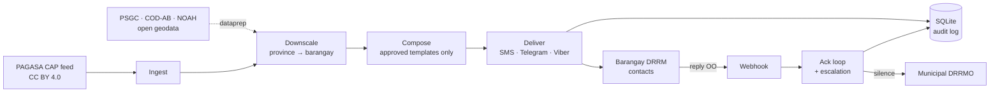

# Abiso: barangay disaster-alert relay

[](https://github.com/eaarrll/abiso/actions/workflows/ci.yml)
[](LICENSE)

PAGASA issues weather warnings per **province**, in technical language. The legal duty to act on them (opening the evacuation center, moving families out) sits with the **barangay**. Deaths in recent typhoons (Kristine 2024, Kalmaegi/Tino 2025) clustered where a rainfall warning never became a barangay-level instruction, and where nobody could say whether the warning had even been received.

Abiso fills that gap. It reads the official PAGASA warning feed and works out which barangays are actually exposed. It sends each one a plain-language SMS in Filipino or English, waits for the barangay's DRRM contact to reply, and escalates if nobody answers.

> **Relay only.** Every message is attributed to PAGASA and timestamped. Abiso never forecasts and never orders an evacuation; that authority belongs to the punong barangay and the local DRRM council (RA 10121).

## What it does that other alert tools don't

| | |
|---|---|
| **Barangay-level targeting** | PAGASA's alerts stop at the province. Abiso intersects each alert's polygon with barangay boundaries (OCHA COD-AB) and ranks the barangays by UP NOAH flood, storm-surge and landslide exposure. In the Cebu pilot data that's 1,202 barangays, each with its own hazard profile. |
| **Fails closed** | Messages come only from human-translated templates. If a detail is missing (for example the barangay's evacuation center), it **refuses to send** and records why, instead of sending half an instruction. There's no machine translation or LLM anywhere in the alert path. |
| **Closes the loop** | Barangay contacts reply `OO` or `YES`. If they don't, the alert escalates: re-send at 10 minutes, a call task at 25, an SMS to the municipal DRRMO at 40. Every step is written to an append-only audit log, which is the accountability record RA 12287 asks LGUs to keep. |
| **Safe by default** | Everything runs in dry-run. Nothing reaches a phone unless `ABISO_LIVE=1` *and* that channel has credentials. Because a reply stops an escalation, every inbound webhook checks a shared secret or signature, and a channel with no secret configured accepts nothing. |

## Architecture



Each stage is a short-lived process that is safe to re-run (idempotent), driven by a 5-minute loop. There's no queue and no broker: at pilot scale the database is the coordination point, and recovering from a crash just means waiting for the next tick. The design choices and trade-offs are in **[ARCHITECTURE.md](ARCHITECTURE.md)**. The research behind them (channels, language, legal position) is in **[PLAN.md](PLAN.md)**.

## Output from a drill

The SMS sent to a barangay captain for a PAGASA Extreme flood advisory. It's one GSM segment (157 of 160 characters, ₱0.56):

```
PAGASA Baha-Extreme Hul2 8PM: Brgy Cansaga: Malubhang baha. Kung malapit sa
ilog o mababang lugar, pumunta sa Cansaga Barangay Hall. Reply OO kung natanggap.
```

The acknowledgment timeline produced after the event ([full report](docs/sample-ack-report.md)):

```
BDRRMC ack rate: 1/1 (100%)

Brgy Cansaga (0702219002)
- ✅ Kap. Demo Lang (bdrrmc): acked in 14.8 min
- ⚠️ escalated: resend_sms at 17:27Z

Brgy IV Pob. (0702252051)
- ❌ failed: missing slot 'evac' for template flood_extreme/fil
     — refusing to send incomplete instructions
```

The second barangay hadn't registered an evacuation center yet, so Abiso sent it nothing and recorded exactly why.

## Engineering

- **47 tests, no network needed.** They cover CAP parsing, matching alerts to barangays (including same-name barangays and old vs new PSGC codes), dispatch idempotency, the severity gate, the escalation order, and webhook authentication (a forged or unsigned reply is rejected and never recorded). Every template in every language must fill all its slots, use only GSM-7 characters and fit in one SMS segment, and **CI enforces this**.
- **CI** ([`.github/workflows/ci.yml`](.github/workflows/ci.yml)) runs lint and tests on Python 3.11, 3.13 and 3.15 (the image's runtime), checks the Terraform with `fmt` and `validate`, builds the Docker image, and on `main` publishes it to GHCR. Dependabot covers pip, Actions, Docker and Terraform.
- **Container** ([`Dockerfile`](Dockerfile), [`compose.yaml`](compose.yaml)): one non-root image runs as both the webhook and the worker, with Caddy in front for automatic HTTPS. SQLite lives on a local volume.
- **Infrastructure as code** ([`deploy/terraform`](deploy/terraform)): one Azure VM in Southeast Asia that starts the stack on first boot (cloud-init). Only ports 80 and 443 are open to the internet, and SSH is limited to one admin IP range, enforced by a Terraform variable check. The VM's Azure DNS label gives Caddy a hostname for its certificate. Secrets stay out of Terraform state: the VM boots in dry-run and credentials are added over SSH.

## Run it

```sh
make setup       # venv + dependencies
make test        # 47 tests, no network
```

Everything else needs the open geodata (it downloads PSGC, COD-AB and NOAH, which takes a few minutes):

```sh
make dataprep    # gazetteer, boundaries and hazard layers → warehouse/*.parquet

# Preview the messages a sample alert produces (--allow-draft also renders Cebuano)
.venv/bin/python -m pipeline.compose.render tests/fixtures/gfa_sample.cap \
    --psgc 0702219002 --allow-draft

make poll        # fetch the live PAGASA CAP feed once
make dispatch    # downscale, compose and "send" (dry-run)
make ackloop     # match replies, fire due escalations
make report      # acknowledgment timeline for the latest alert
```

Add a subscriber (consent reference is required, per the Data Privacy Act):

```sh
.venv/bin/python -m pipeline.deliver.subscribers add \
    --psgc 0702219002 --tier bdrrmc --name "Kap. Juan Dela Cruz" \
    --msisdn +639171234567 --consent-ref "onboarding form 2026-07-10"
```

### Deploy

```sh
cp .env.example .env                             # dry-run until you set ABISO_LIVE=1
docker compose run --rm worker make dataprep     # one-off
docker compose up -d                             # webhook + worker + Caddy
```

Or on Azure: `cd deploy/terraform`, copy `terraform.tfvars.example` to `terraform.tfvars`, then `terraform apply`.

To go live, set `ABISO_LIVE=1` plus `SEMAPHORE_API_KEY` and `SMS_SENDER_NAME` (the sender ID must be registered with the SMS aggregator), and optionally `TELEGRAM_BOT_TOKEN` and `MESSENGER_VERIFY_TOKEN`.

Each inbound channel also needs its secret (generate one with `openssl rand -hex 32`):

| Channel | Variable | Where it goes |
|---|---|---|
| SMS replies | `WEBHOOK_TOKEN` | the aggregator's callback, as an `X-Abiso-Token` header, or `https://<host>/webhook/sms?token=…` if it can't set headers |
| Telegram | `TELEGRAM_WEBHOOK_SECRET` | `curl "https://api.telegram.org/bot$TELEGRAM_BOT_TOKEN/setWebhook" -d url=https://<host>/webhook/telegram -d secret_token=$TELEGRAM_WEBHOOK_SECRET` |
| Messenger | `MESSENGER_APP_SECRET` | your Meta app's secret, which signs every delivery | Viber Community posts are pasted by an operator from `data/outbox/viber/`, because the Viber bot API costs €100 a month, which isn't worth it at barangay scale.

## Status and known gaps

All software phases are complete and can be rehearsed end to end in dry-run. It has **not been run live**. Before a real pilot:

- **Cebuano templates** are drafts (`needs_review`) until a translator and the barangay DRRM councils validate them. Filipino and English are approved.
- **Operational lead time:** registering the SMS sender ID takes 2 to 4 weeks, and each barangay has to be onboarded (contacts, consent, evacuation centers).

## Data sources

- [PAGASA CAP feed](https://publicalert.pagasa.dost.gov.ph/feeds/): official warnings, CC BY 4.0
- [UP NOAH hazard maps](https://huggingface.co/datasets/bettergovph/project-noah-hazard-maps) (BetterGov mirror): flood, storm-surge and landslide susceptibility, ODbL
- [PSA PSGC](https://psgc.gitlab.io/api) and [OCHA COD-AB](https://data.humdata.org/dataset/cod-ab-phl): barangay codes and boundaries

Code is MIT-licensed. The datasets keep their own licenses, and no derived data is committed to this repo.
